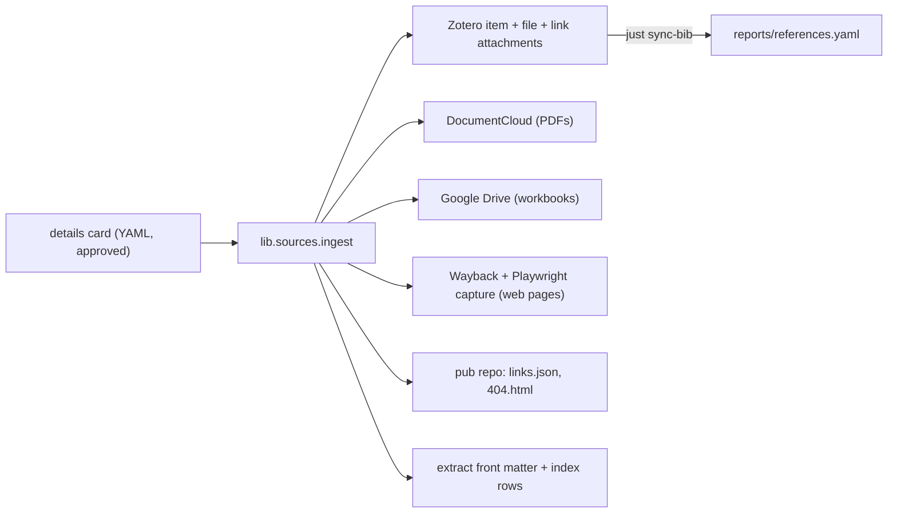

# Source ingest: architecture

Design of the pipeline that brings sources into Zotero, public hosts, short links and `context/sources/`. The user-facing description is `sources_user_guide.md`; naming rules are in `source_metadata_conventions.md`. Code is in `lib/sources/`.

## Principles

1. **The agent decides, the CLI does.** All judgment (item type, creators, title, citation key, project, DOI, one-line index row) is made by an agent and approved by a person, then frozen in a YAML **details card** (`metadata.SourceMetadata`). The CLI (`lib/sources/ingest.py`) does only deterministic writes from that card. Validation (`metadata.problems`) enforces the conventions again, so a bad card fails before any write.
2. **The systems are the state.** There is no local state file. Each step reads the real system and does only what is missing: the Zotero item with this pinned key; the DocumentCloud ID in the item's Extra (or a document tagged with the citation key); attachments by md5; link attachments by URL; the entry in `links.json`; front-matter fields in the extract; index rows by path. A re-run after any failure therefore converges without duplicates. Tests inject a failure at each step and re-run.
3. **`processed` goes last.** The Zotero tag `processed` is added only after `verify` passes. Items without it are what `pending` lists.
4. **Public copies are separate from the record.** Zotero holds the original; the public host holds a copy readers can open; the short link (`pub.switch.box/<key>`) is the permanent citation URL.

## Data flow

## Ingest steps (in order)

| Step                         | What it does                                                                                                                               | Resume check                                                                                      |
| ---------------------------- | ------------------------------------------------------------------------------------------------------------------------------------------ | ------------------------------------------------------------------------------------------------- |
| validate                     | card conventions, organization and duplicate checks                                                                                        | none (pure)                                                                                       |
| projects                     | create a missing project collection and `context/sources/<project>/`                                                                       | collection exists                                                                                 |
| file                         | find the original (`--path-source`, `--path-source-dir`, provenance CSV, or the item's own attachment)                                     | none                                                                                              |
| zotero_item                  | create the item with the pinned key in Extra, or adopt `--zotero-item`; place it in project collections                                    | item with this pinned key (a different document under the same key is an error, `_same_document`) |
| capture                      | web pages: Playwright PDF and HTML, HTML converted to markdown                                                                             | existing capture attachment                                                                       |
| documentcloud start          | upload PDF tagged with the key; record its ID in Extra                                                                                     | ID in Extra, or tagged document                                                                   |
| zotero_files                 | attach the original; `url` set to `https://doi.org/<doi>` or the short link; original `source_url` and the public copy as link attachments | md5 of attachments, URLs of links                                                                 |
| documentcloud wait           | poll until `success`, make public                                                                                                          | status                                                                                            |
| drive                        | workbooks: upload with `appProperties`, anyone-reader                                                                                      | `appProperties` and md5                                                                           |
| wayback                      | web pages: SPN2 save (`Authorization: LOW access:secret`, anonymous fallback); blocked sites are reported                                  | `Wayback URL` in Extra                                                                            |
| short_link                   | add to `links.json` and regenerate `404.html`; one commit and push per batch                                                               | entry already equal                                                                               |
| front_matter                 | flat fields written line by line (inline comments survive)                                                                                 | field equal                                                                                       |
| index                        | one row per file in the global index and the folder README                                                                                 | row by path                                                                                       |
| verify, then `processed` tag | re-read everything; tag last                                                                                                               | tag                                                                                               |

The DocumentCloud upload starts before the Zotero file upload and is waited on afterwards, so the two transfers overlap without threads.

## Zotero conventions in the writes

- **Pinned key:** `Citation Key:` line in Extra; `tex.shortauthor:` for the short form. Managed lines `DocumentCloud ID`, `Google Drive ID` and `Wayback URL` are stripped from the CSL `note` in `bib.py`, so they never reach `references.yaml`.
- **Writes** go through `zotero_write`: versioned (`If-Unmodified-Since-Version`), one retry on 412 with a re-read, a JSONL log of every write with the prior value (`~/.cache/switchbox_sources/logs/zotero_writes.jsonl`), rollback from the log (`entries_to_undo`), and a write token derived from the citation key (sha256, 32 characters) so a retried create cannot duplicate.
- **Library cache:** the whole library is cached on disk and refreshed incrementally by library version, so lookups (duplicates, pinned keys, organizations) cost one request.
- **Pending:** items in the group library added since `PENDING_SINCE` (`SOURCES_PENDING_SINCE` overrides it) that lack the `processed` tag, and are not attachments or notes. Fetched in pages of 25 to keep the session-start hook fast.
- **Collections:** projects are subcollections of `Reports`. A top-level `Inbox` collection is where hand-saved items land; `doctor` reports it when it is missing rather than failing.

## Public hosts

- **DocumentCloud** (`python-documentcloud`): default for PDFs unless the source has a DOI, is a web page, or is a workbook; the card can override. Documents are tagged with the citation key as `data_citekey`, so a lost ID is recoverable.
- **Google Drive** (v3, user OAuth): workbooks only; files get `appProperties` (citekey, md5) so a re-run finds them; sharing is anyone-reader; the folder is `GDRIVE_PUBLIC_FOLDER_ID` (shared drives need `supportsAllDrives`). Auth reuses the OAuth app (`G_*`) and cached token of `lib/data/gsheets.py` through `get_user_credentials()`, which refreshes the token and never opens a browser (no token raises `GoogleLoginRequired`: run `just google-login` once). Uploads run as the teammate running ingest; because the folder is in a shared drive, Switchbox (not that teammate) owns the files. Requirements: the Workspace admin must allow "anyone with the link" sharing for the shared drive, and if the OAuth consent screen is External with publishing status Testing, refresh tokens expire every 7 days (an Internal app avoids this).
- **Wayback SPN2:** POST `https://web.archive.org/save` (without `capture_all`, so SPN2 refuses 4xx/5xx pages with `error:not-found` and similar); poll status; failures matching known blockers are reported as "blocked", not retried. A capture whose page answered 4xx/5xx (`http_status` in the status response, or the status Wayback replays for the snapshot when that field is missing, as on the anonymous legacy endpoint) is a failure, not a block.
- **Web capture:** Playwright Chromium renders the PDF and HTML; the HTML is converted to markdown for the extract.

## Short links

`switchbox-data/pub` serves GitHub Pages at `pub.switch.box`. `links.json` is the source of truth; `404.html` is generated from it (the map is embedded as a `var LINKS = {...};` line, values escaped for safe JS, forwarding with `location.replace`, no `innerHTML` with link data). `shortlinks.py` works on a local clone in `~/.cache/switchbox_sources/pub`, pulls before editing, and makes **one commit and one push per batch**. A key already pointing elsewhere is not overwritten unless the card repoints it. `SOURCES_PUB_REMOTE` replaces the remote (tests use a local bare repo).

## Repo-side files

- **Front matter** (flat): `source_file`, `citekey`, `zotero_item`, `public_url`, `short_url`, `source_url`, `md5`, `validated`, then descriptive fields (`docket`, `utility`, `filing_date`, `filer`, `document_type`, `pages_total`, `extraction_scope`, `why_here`). `original_pdf_path` is dropped and the legacy `source` is `source_file`.
- **Index:** one row per file in the `## sources/` table of `context/README.md`, keyed by path. A `(directory)` row covers files in that folder; a folder README's `File` table gets a row too.
- **Workbooks:** `.xlsx` files under 600 KB can stay in the repo (the pre-commit size hook is the limit); larger ones are fetched from Zotero on demand. The markdown next to a workbook is a stub.
- **PDFs** are gitignored (`context/sources/**/*.pdf`); `just fetch-source` restores them.

## Session-start reminder

`.cursor/hooks.json` registers a `sessionStart` hook running `.cursor/hooks/sources-pending.sh`, which calls `cli pending --hook`. It prints JSON `{"additional_context": "..."}` when items are pending, and `{}` otherwise (no credentials, no network, no `.venv`, nothing pending), and always exits 0. Cursor's hooks documentation lists `env` and `additional_context` as the `sessionStart` outputs and runs the hook fire-and-forget, so it cannot block a session. The script drains the JSON Cursor sends on stdin, and runs `uv run --no-sync` so a stale `.venv` never starts a sync (which would outlast the 15 s timeout); it takes 2-3 s with a few pending items, up to ~11 s at the 200-item page cap. AGENTS.md tells agents to mention the reminder once and not to ingest without being asked.

## Migration tooling (phase 5)

`draft-cards` turns the staging provenance CSV into pre-filled draft cards (project from the repo path, item type from the document type, docket title from the CSV) that an agent completes and a person approves. `ingest --extract` reuses an existing extract instead of re-extracting; `--path-provenance-csv` finds each original by extract path. `convert-frontmatter` rewrites legacy front matter to the flat schema (dry run unless `--apply`); folders with a `MANIFEST.csv` fill `source_url` and `md5` from it. None of this runs automatically.

## Testing

`tests/sources/` mocks every network call with in-memory fakes of Zotero, DocumentCloud, Drive, Wayback and the `pub` remote (a local bare repository). The ingest tests inject a failure at each step and assert that a second run converges with no duplicate items, attachments, links or rows. What the mocks cannot show (real API behaviour) is listed in the PR that introduced the pipeline.
